# Material Browser

An encrypted browser-profile workspace for Windows x64, with optional self-hosted storage.

Super Profiles add encrypted reusable guest templates, revision history and explicit
browser/workspace save-back. Native WSL2 and Windows Sandbox source is under acceptance;
template storage and successful compilation do not prove every guest experience works.
See [the workflow and current limits](docs/features/desktop/super-profiles.md).

**Development status:** unsigned development installers and the portable offline handbook are available through [normal automated releases](https://github.com/Ding-Ding-Projects/material-browser/releases). The product remains incomplete. Native installation/update acceptance, portable browser credentials, stable advanced identity, consistent live snapshots and two-computer restoration remain unverified or unsupported.

- [Interactive handbook and complete documentation](https://ding-ding-projects.github.io/material-browser/)
- [Reviewed interface screenshot gallery](https://ding-ding-projects.github.io/material-browser-evidence/) with its original per-image hashes and capture provenance
- [Architecture](docs/architecture.md)
- [Required-feature acceptance and remaining gaps](docs/features/acceptance/README.md)
- [Server management implementation and verification limits](docs/features/servers/README.md)
- [Roadmap](ROADMAP.md) and [current handoff](HANDOFF.md)
- [Windows build and release automation](docs/features/delivery/windows-automation.md)
- [Browsers and automation runtimes bundled in the installer](docs/features/delivery/bundled-engines.md)

## Desktop workflow

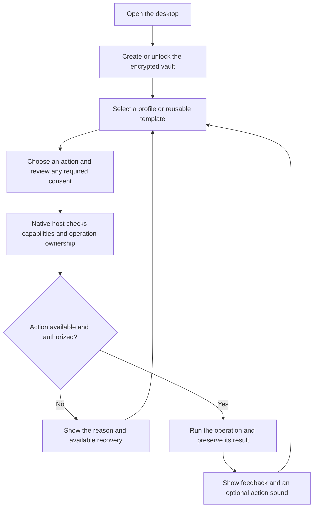

## Bundled engines and launch behavior

The installer includes complete Chromium 158.0.8111.0 (official development snapshot 1721569), Firefox 158.0, matching drivers, Node 26.4.0 and locked automation dependencies. These runtime files live outside the application archive, with pinned vendor archives, complete extracted inventories and retained licenses. Browser startup does not require a separate browser download.

Both bundled engines passed Off, Selenium and Puppeteer launch/normal-stop checks in the combined packaged native host at source `04e003fb37fcdc5fecb8ef45806aaae74a69b603`. All four automation clients completed real title roundtrips. The native host exited successfully. After an initial ancestry rejection resolved, a fresh full ownership proof permitted normal wrapper exit; its recorded processes were proven absent and the exact hidden desktop closed. [Runtime summary and limits](docs/evidence/desktop/bundled-runtime-04e003f.json). Standard-identity launch requires an explicit per-launch choice because advanced stable identity is unavailable; saved identity metadata is not enforced by these stock engines.

Builds enter through build.bat; installer production enters through build-installer.bat. Hosted builds run on every branch push and manual dispatch, use increasing package versions and publish normal development releases. Tests and lint run locally, not in the hosted workflow. Each release asset is transferred separately and checked against its published byte count and SHA-256.

## Desktop design

The desktop interface follows the eight Material 3 Expressive artboards in [the design folder](design/IMPLEMENTATION_HANDOFF.md): a custom title bar with search, a 96 dp navigation rail, rounded panes, segmented lists, connected button groups and the two-key confirmation. The vendored `design/m3.css` anatomy drives the renderer directly, with colour roles bridged to the saved theme, accent and contrast choices.

Short completion and failure tones are configurable in **Settings → Notifications**, with a persisted switch, volume and preview. Quiet hours and accessibility settings take precedence. [Sound behavior](docs/features/desktop/action-sounds.md).

## Current desktop screenshots

Captured from the running application (real Electron shell and native host, disposable data) at source `264d81d` on Linux. [Capture method, hashes and limits](docs/evidence/desktop/m3-redesign/README.md).

| | |
| --- | --- |
| 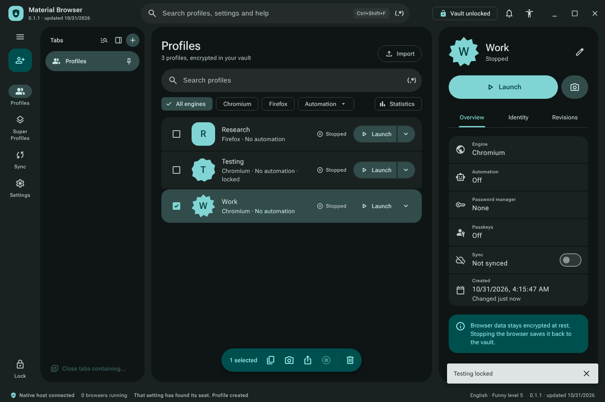 | 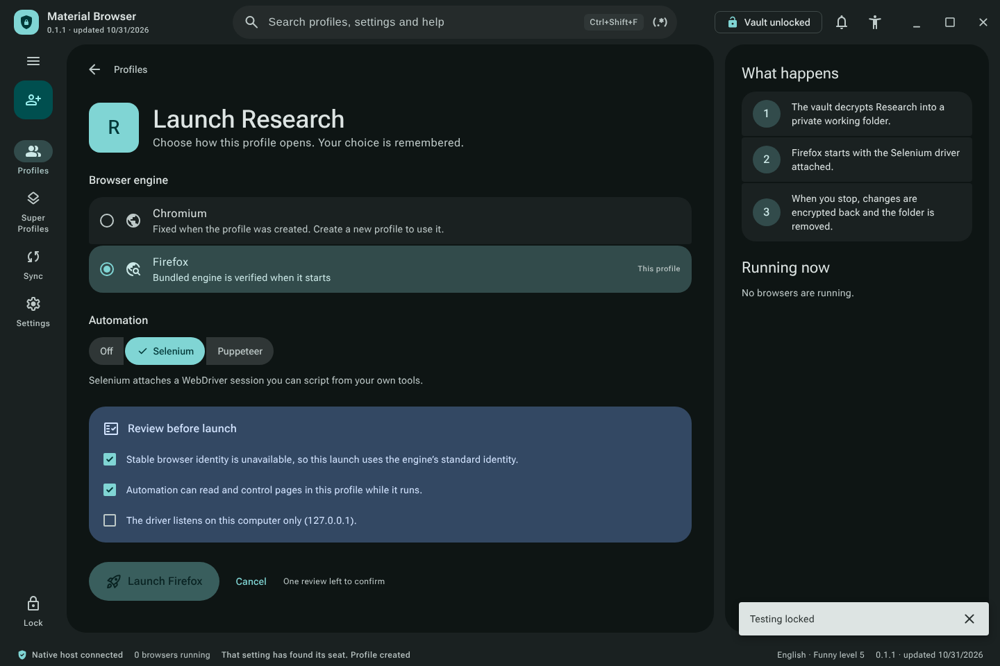 |
| Profiles: list-detail, split launch buttons, floating toolbar | Launch: engine, automation and the review card |
| 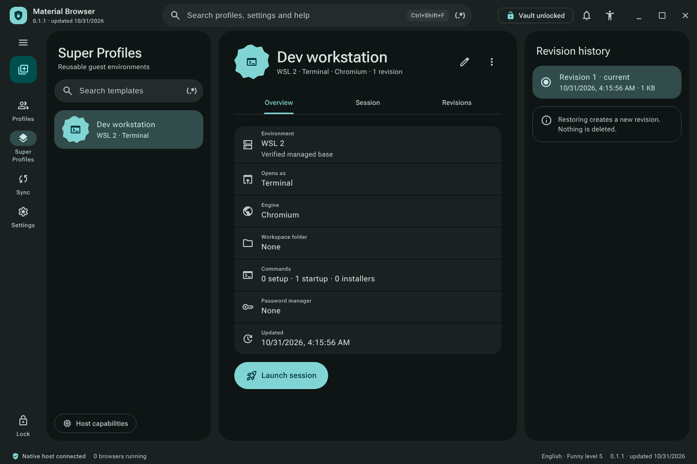 | 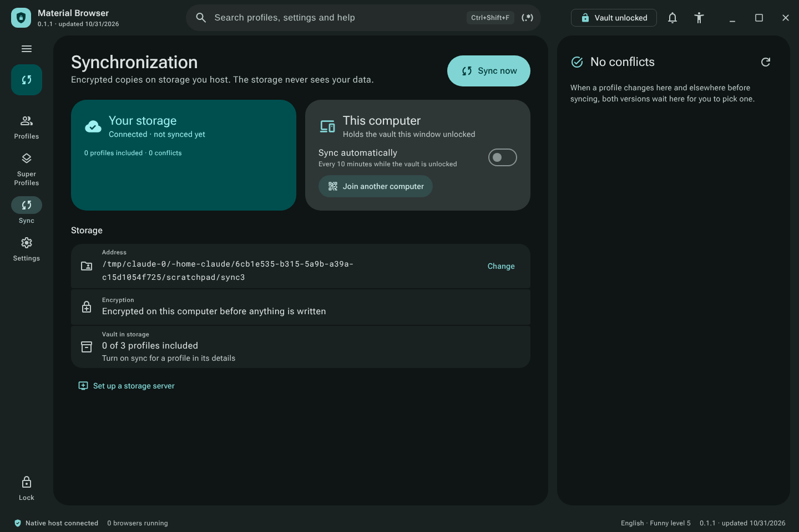 |
| Super Profiles: template, overview and revision history | Synchronization: storage, this computer and conflicts |
| 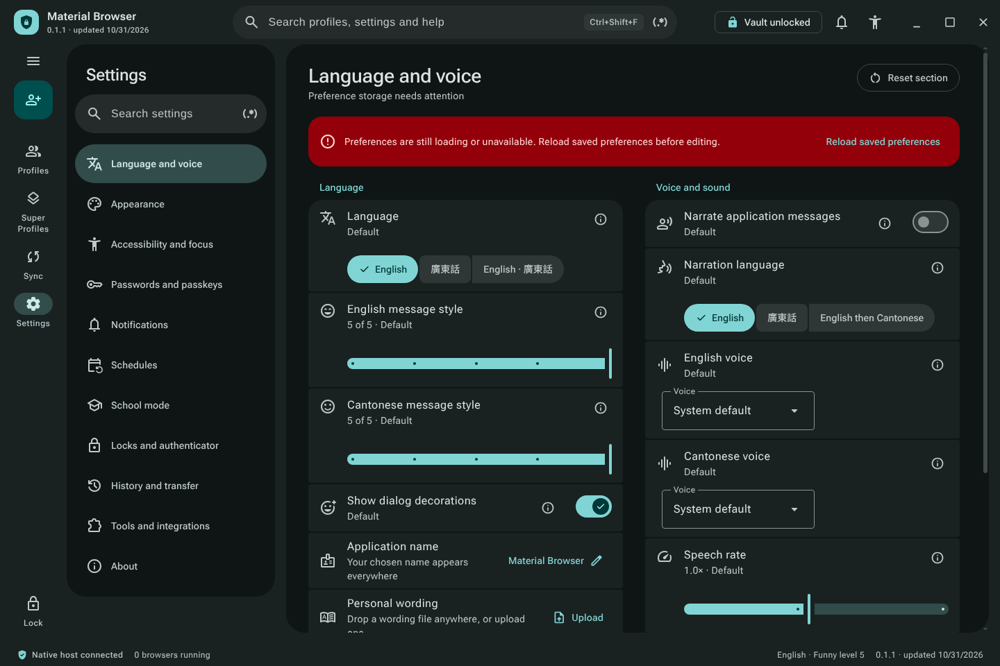 | 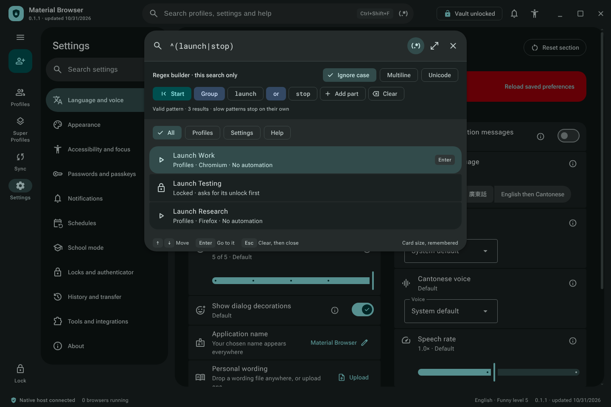 |
| Settings: navigation drawer and segmented lists | Command palette with the regex builder |
| 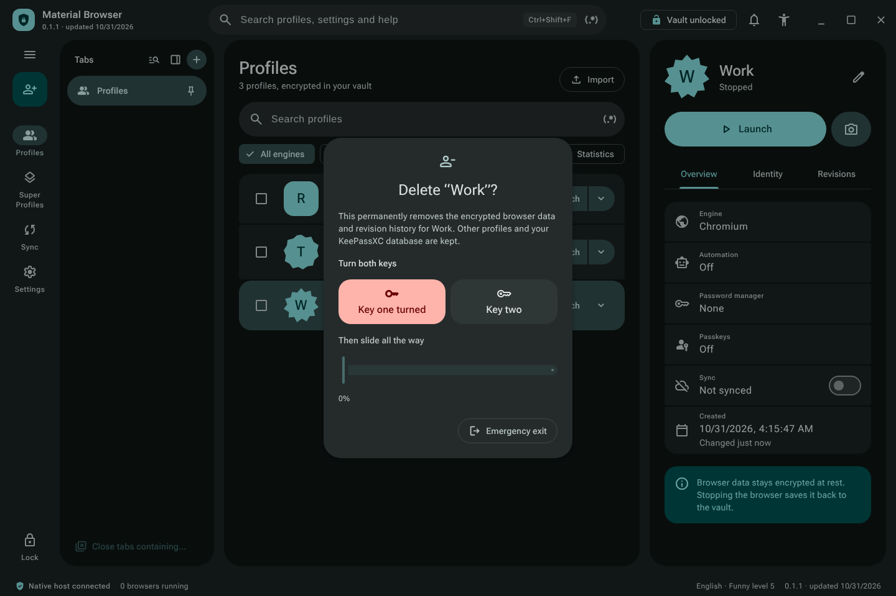 | 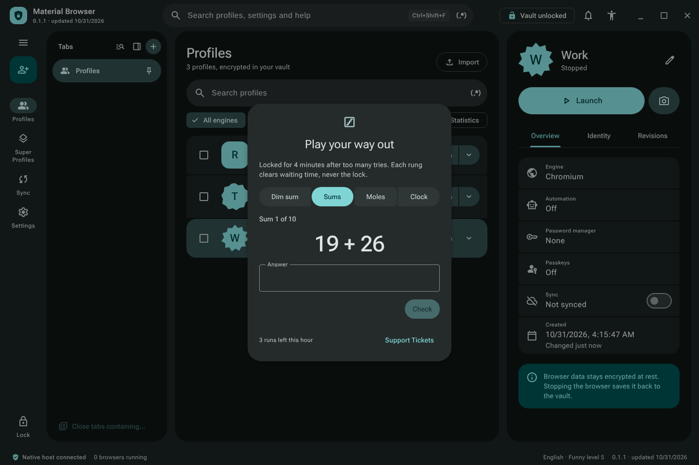 |
| Two-key confirmation before a delete | Unlock ladder for an element lock |
| 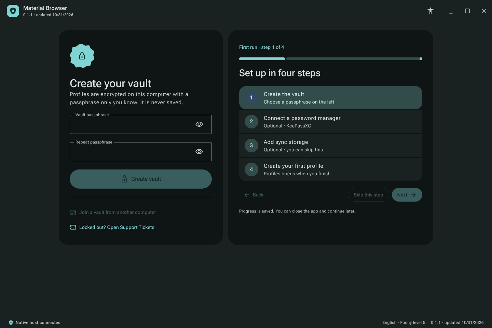 | 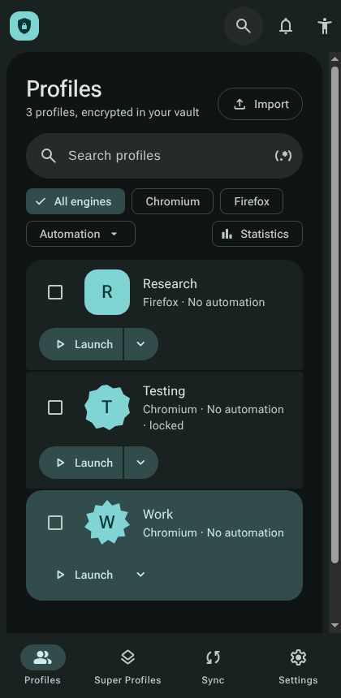 |
| First start: create the vault | Compact window |

Earlier native Windows captures from released version 0.1.58 remain described in [the preservation record](docs/evidence/desktop/native-preservation.md); [historical WorldLens captures](docs/evidence/desktop/worldlens/README.md) and the [earlier image archive](docs/evidence/archive.md) are kept for their original sources.

## Documentation and remaining work

The hosted handbook retains complete documentation/wiki articles and interactive task guides. Automated releases also include a single-file offline handbook. Earlier source-bound handbook interaction and restart observations remain in the archive; current-source companion runtime acceptance is not inferred from packaging success.

The encrypted core, native control transports, settings/history integration, storage service and hosting wizard have source implementations. Their broad required-feature inventories remain incomplete. See the roadmap and categorized documentation for exact limitations. The existing installed 0.1.0 desktop may remain active while a newer installer is prepared; it must reach a safe normal lifecycle boundary before an update is applied.
