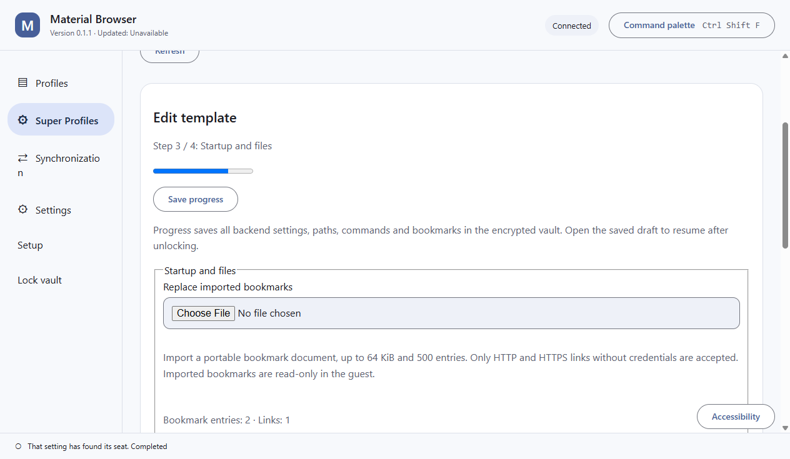

# Material Browser

An encrypted browser-profile workspace for Windows x64, with optional self-hosted storage.

Super Profiles add encrypted reusable guest templates, revision history and explicit
browser/workspace save-back. Native WSL2 and Windows Sandbox source is under acceptance;
template storage and successful compilation do not prove every guest experience works.
See [the workflow and current limits](docs/features/desktop/super-profiles.md).

**Development status:** unsigned development installers and the portable offline handbook are available through [normal automated releases](https://github.com/Ding-Ding-Projects/material-browser/releases). The product remains incomplete. Native installation/update acceptance, portable browser credentials, stable advanced identity, consistent live snapshots and two-computer restoration remain unverified or unsupported.

- [Interactive handbook and complete documentation](https://ding-ding-projects.github.io/material-browser/)
- [Architecture](docs/architecture.md)
- [Roadmap](ROADMAP.md) and [current handoff](HANDOFF.md)
- [Windows build and release automation](docs/features/delivery/windows-automation.md)
- [Browsers and automation runtimes bundled in the installer](docs/features/delivery/bundled-engines.md)

## Bundled engines and launch behavior

The installer includes complete Chromium 158.0.8111.0 (official development snapshot 1721569), Firefox 158.0, matching drivers, Node 26.4.0 and locked automation dependencies. These runtime files live outside the application archive, with pinned vendor archives, complete extracted inventories and retained licenses. Browser startup does not require a separate browser download.

Both bundled engines passed Off, Selenium and Puppeteer launch/normal-stop checks in the combined packaged native host at source `04e003fb37fcdc5fecb8ef45806aaae74a69b603`. All four automation clients completed real title roundtrips. The native host exited successfully. After an initial ancestry rejection resolved, a fresh full ownership proof permitted normal wrapper exit; its recorded processes were proven absent and the exact hidden desktop closed. [Runtime summary and limits](docs/evidence/desktop/bundled-runtime-04e003f.json). Standard-identity launch requires an explicit per-launch choice because advanced stable identity is unavailable; saved identity metadata is not enforced by these stock engines.

Builds enter through build.bat; installer production enters through build-installer.bat. Hosted builds run on every branch push and manual dispatch, use increasing package versions and publish normal development releases. Tests and lint run locally, not in the hosted workflow. Each release asset is transferred separately and checked against its published byte count and SHA-256.

## Current Super Profiles screenshot

This original renderer image shows the packaged desktop at source
`4e8ff77744ab69bf811c917c9db3932b00c36858`, built through the exact root Desktop installer
entrypoint. It came from a fresh owned native launch on an isolated hidden desktop and was
inspected for private data and promoted without changing its bytes. The viewport is 1264 by
735, English/light, logical scale 1. Native display DPI was 96.

This fresh workflow saved encrypted setup progress, kept one identity on repeated saves and
reopened the saved step. The earlier [full wizard workflow](docs/evidence/super-profiles/wizard-50ddbbc.json)
separately verified restart/unlock, invalid-file retention and backend separation. Its source
identity is retained. The frontend executable and application archive are byte-identical
between those two builds; the later native host contains the desktop handoff repairs.

The current image proves the visible wizard state. It does not prove a graphical guest,
physical display scaling, complete keyboard accessibility or installer acceptance. Nine
fresh targeted layout retakes passed, while one tuple stopped before interaction at its
process-ownership check. No complete final-source visual matrix is claimed.

[Current image inventory](docs/evidence/super-profiles/inventory.json) ·
[Build and workflow receipts](docs/evidence/super-profiles/wizard-50ddbbc.json) ·
[Earlier desktop images and provenance](docs/evidence/archive.md)

## Documentation and remaining work

The hosted handbook retains complete documentation/wiki articles and interactive task guides. Automated releases also include a single-file offline handbook. The source-50ddbbc portable handbook passed one-file launch, internal home/article/wiki navigation, the three-step Super Profiles guide and progress persistence after reload. Current-source companion production and verification remain separate from the desktop build.

The encrypted core, native control transports, settings/history integration, storage service and hosting wizard have source implementations. Their broad required-feature inventories remain incomplete. See the roadmap and categorized documentation for exact limitations. Live installation discovery found no matching installed desktop. Historical installation statements remain in the archive; no installed-update result is claimed.
