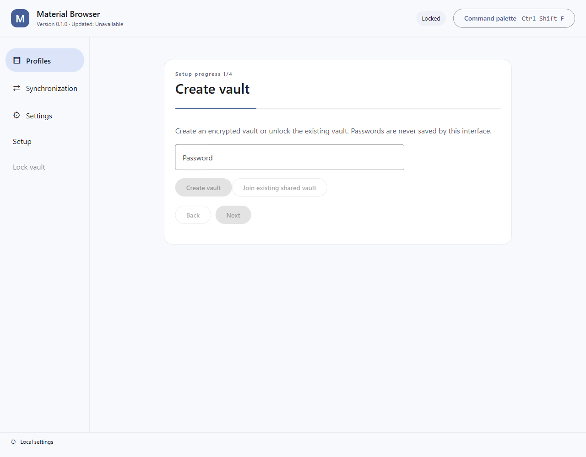
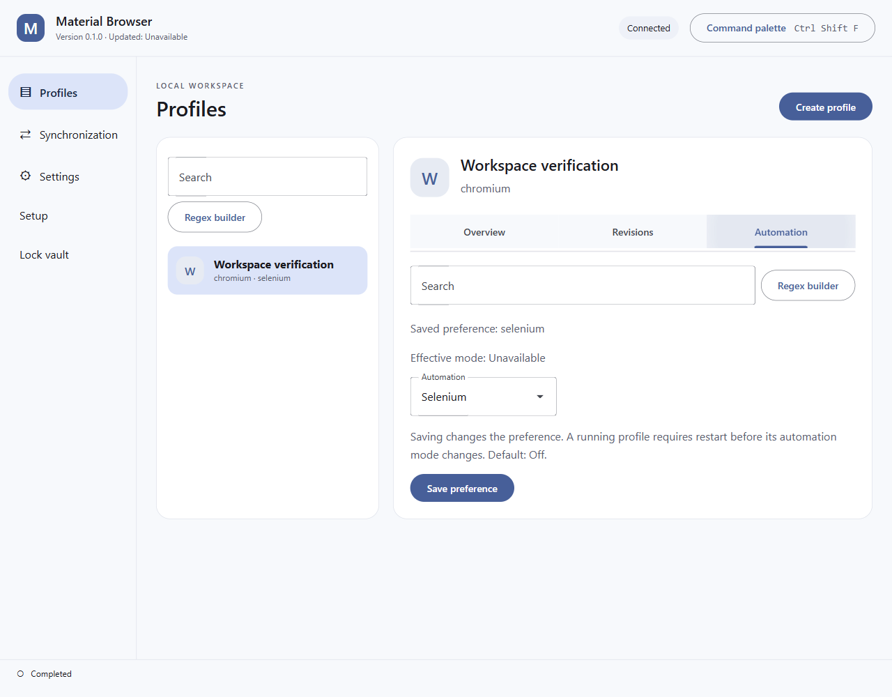
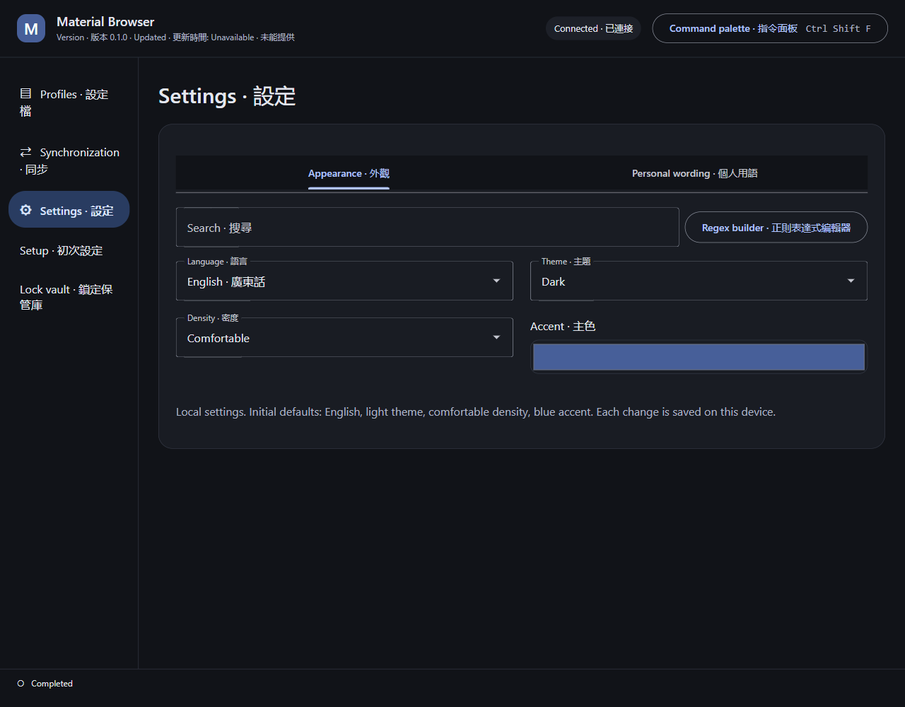

# Material Browser

An encrypted browser-profile workspace for Windows, with optional self-hosted storage.

**Development status:** source implementation and focused local checks are in progress. There is no verified release yet.
Live snapshots, portable browser credentials and advanced identity controls require managed
browser integrations and must not be inferred from the interface or profile-file copying.

- [Architecture](docs/architecture.md)
- [Roadmap](ROADMAP.md)
- [Handoff](HANDOFF.md)
- [Continuation state](CLOSEOUT_PROMPT.md)

The encrypted core, desktop workspace, native control transports, interactive documentation,
storage service and portable hosting wizard have source implementations. Focused checks have
passed separately, but the combined application is not release-ready. Real Chromium and
Firefox attempts reached normal-mode launch and then failed at graceful stop. A subsequent
repair needs a newly built runtime matrix. Native credential portability, consistent live
snapshots and advanced identity controls remain incomplete. No published container,
documentation deployment or end-to-end two-computer proof is claimed.

## Desktop capture evidence

These genuine captures show the packaged desktop at source `7257d2238a6c6a495c84321a98bffc283450af9c`, built through `build-installer.bat -Component Desktop`. They use a fresh synthetic vault and the real bundled native host on an isolated background desktop. The page viewport is explicitly emulated at 1280 by 1000, scale 1; this is not a claim of physical display-scale coverage.

The workflow created a vault and profile, skipped optional synchronization, saved automation from Off to Selenium, and changed language/theme through the interface. Effective automation remains unavailable: no managed browser was launched in this capture run. The updated-at value remains unavailable. Native installation, restart persistence, keyboard-only input, a complete scale/language matrix and overall accessibility acceptance remain unverified. [Evidence inventory](docs/evidence/desktop/inventory.json).
