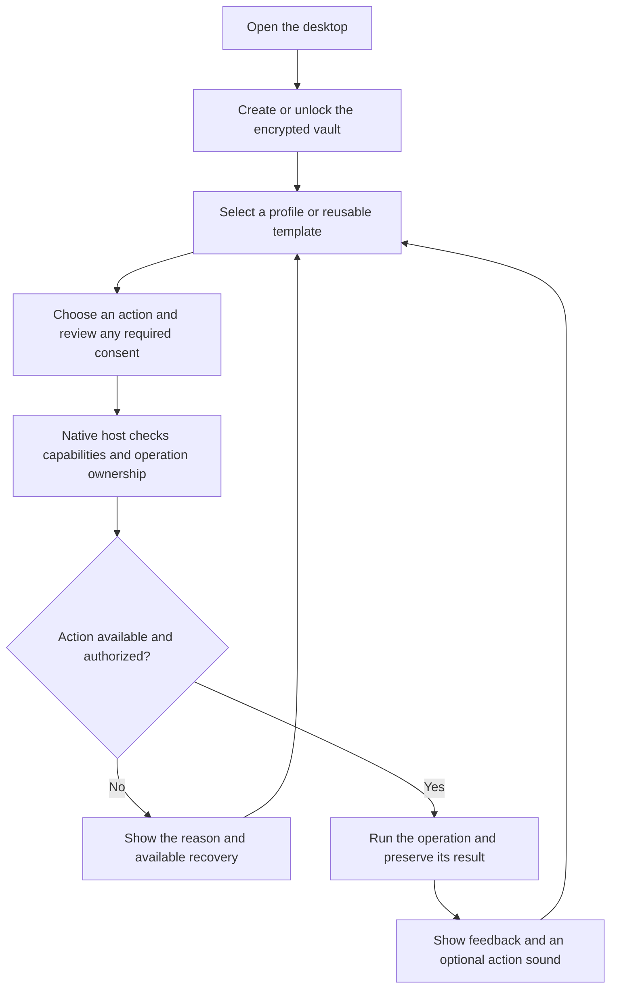

# Material Browser

An encrypted browser-profile workspace for Windows x64, with optional self-hosted storage.

Super Profiles add encrypted reusable guest templates, revision history and explicit
browser/workspace save-back. Native WSL2 and Windows Sandbox source is under acceptance;
template storage and successful compilation do not prove every guest experience works.
See [the workflow and current limits](docs/features/desktop/super-profiles.md).

**Development status:** unsigned development installers and the portable offline handbook are available through [normal automated releases](https://github.com/Ding-Ding-Projects/material-browser/releases). The product remains incomplete. Native installation/update acceptance, portable browser credentials, stable advanced identity, consistent live snapshots and two-computer restoration remain unverified or unsupported.

- [Interactive handbook and complete documentation](https://ding-ding-projects.github.io/material-browser/)
- [Reviewed interface screenshot gallery](https://ding-ding-projects.github.io/material-browser-evidence/) with its original per-image hashes and capture provenance
- [Architecture](docs/architecture.md)
- [Roadmap](ROADMAP.md) and [current handoff](HANDOFF.md)
- [Windows build and release automation](docs/features/delivery/windows-automation.md)
- [Browsers and automation runtimes bundled in the installer](docs/features/delivery/bundled-engines.md)

## Desktop workflow

## Bundled engines and launch behavior

The installer includes complete Chromium 158.0.8111.0 (official development snapshot 1721569), Firefox 158.0, matching drivers, Node 26.4.0 and locked automation dependencies. These runtime files live outside the application archive, with pinned vendor archives, complete extracted inventories and retained licenses. Browser startup does not require a separate browser download.

Both bundled engines passed Off, Selenium and Puppeteer launch/normal-stop checks in the combined packaged native host at source `04e003fb37fcdc5fecb8ef45806aaae74a69b603`. All four automation clients completed real title roundtrips. The native host exited successfully. After an initial ancestry rejection resolved, a fresh full ownership proof permitted normal wrapper exit; its recorded processes were proven absent and the exact hidden desktop closed. [Runtime summary and limits](docs/evidence/desktop/bundled-runtime-04e003f.json). Standard-identity launch requires an explicit per-launch choice because advanced stable identity is unavailable; saved identity metadata is not enforced by these stock engines.

Builds enter through build.bat; installer production enters through build-installer.bat. Hosted builds run on every branch push and manual dispatch, use increasing package versions and publish normal development releases. Tests and lint run locally, not in the hosted workflow. Each release asset is transferred separately and checked against its published byte count and SHA-256.

## Repository-owned desktop design

The entire desktop interface is being migrated to the current eight artboards and shared styles in [the design folder](design/IMPLEMENTATION_HANDOFF.md). The original attachment is obsolete. The active design source is `0ab6165`; later design updates are reviewed at implementation milestones. Locally bundled reference typography, teal color roles, expressive lists and left-docked tabs retain existing native workflows and saved choices. See [the migration and its limits](docs/features/desktop/zip-gui-remake.md).

Short completion and failure tones are configurable in **Settings → Notifications**, with a persisted switch, volume and preview. Quiet hours and accessibility settings take precedence. [Sound behavior](docs/features/desktop/action-sounds.md).

## Current desktop screenshot acceptance

Five genuine native Windows captures were collected from released version 0.1.58, source `555fa30`, using an isolated hidden desktop and the direct native CLI. They show setup, language Settings, Appearance, empty Profiles and the locked Super Profiles boundary. The seven-process run exited normally. [Observed states and remaining evidence requirements](docs/evidence/desktop/native-preservation.md) distinguish those results from formal promotion. Current screenshot embedding remains pending the required diagnostic/layout receipts.

[Historical WorldLens captures, original inventory and provenance](docs/evidence/desktop/worldlens/README.md) remain preserved for their original source. [Earlier desktop image archive](docs/evidence/archive.md).

## Documentation and remaining work

The hosted handbook retains complete documentation/wiki articles and interactive task guides. Automated releases also include a single-file offline handbook. Earlier source-bound handbook interaction and restart observations remain in the archive; current-source companion runtime acceptance is not inferred from packaging success.

The encrypted core, native control transports, settings/history integration, storage service and hosting wizard have source implementations. Their broad required-feature inventories remain incomplete. See the roadmap and categorized documentation for exact limitations. The existing installed 0.1.0 desktop may remain active while a newer installer is prepared; it must reach a safe normal lifecycle boundary before an update is applied.
