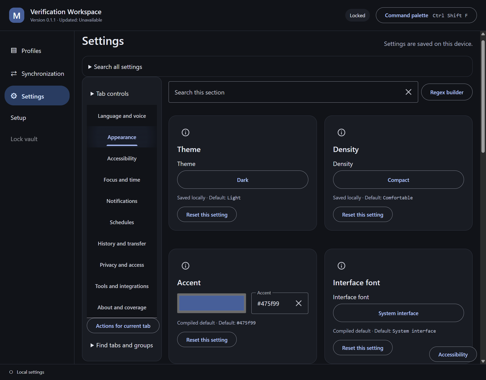
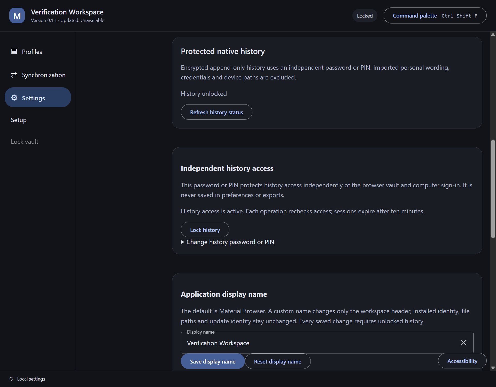
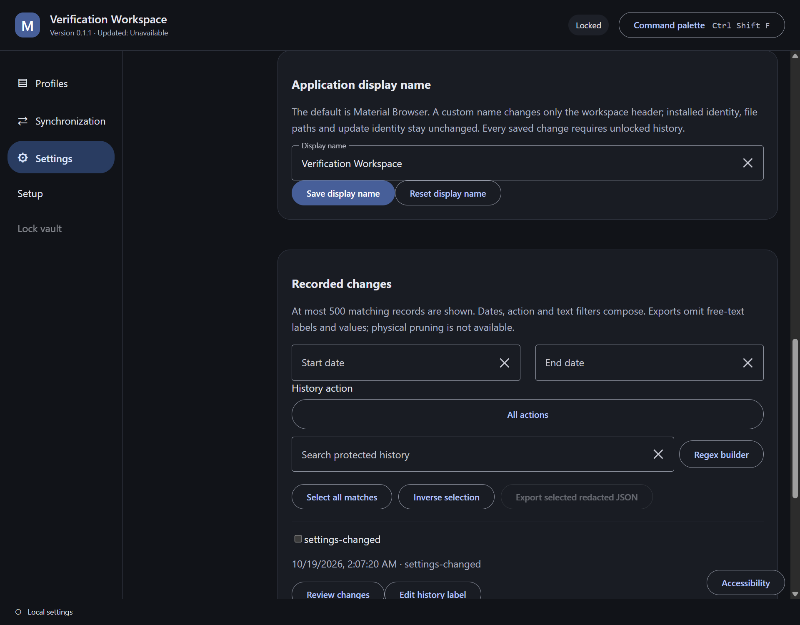

# Earlier presentation archive

## WorldLens presentation retained during the repository-design migration

The former current README images remain unchanged in the
[WorldLens evidence collection](desktop/worldlens/README.md), together with its
[inventory](desktop/worldlens/inventory.json), [provenance](desktop/worldlens/provenance.json)
and original source binding `284fc88f94487a7716099469daadeec258d97b07`. This includes the
profile overview, notification settings, minimum bilingual layout and launch-review images.
Their recorded capture dates and verification limits remain those of the original receipts.
They are historical references and do not prove the new repository-owned design at `0ab6165`.

The earlier desktop and offline-handbook presentation is preserved below as source text. Its original claims and dates are historical, not relabelled as current verification.

[Historical desktop images and provenance](desktop/archive.md) · [Historical portable handbook images and provenance](handbook/README.md)

```markdown
# Material Browser

An encrypted browser-profile workspace for Windows, with optional self-hosted storage.

**Development status:** source implementation and focused local checks are in progress. Automated development installers are [published](https://github.com/Ding-Ding-Projects/material-browser/releases/tag/build-3-39195138374-1); the product is not release-ready and native installation acceptance remains incomplete.
Live snapshots, portable browser credentials and advanced identity controls require managed
browser integrations and must not be inferred from the interface or profile-file copying.

- [Architecture](docs/architecture.md)
- [Roadmap](ROADMAP.md)
- [Handoff](HANDOFF.md)
- [Continuation state](CLOSEOUT_PROMPT.md)
- [Windows build and release automation](docs/features/delivery/windows-automation.md)
- [Browsers and automation runtimes bundled in the installer](docs/features/delivery/bundled-engines.md)
- [Interactive handbook and complete documentation](https://ding-ding-projects.github.io/material-browser/)

The encrypted core, desktop workspace, native control transports, interactive documentation,
storage service and portable hosting wizard have source implementations. Focused checks have
passed separately, but the combined application is not release-ready. The final native
lifecycle candidate passed six real hidden-desktop runs covering both engines locally and
over paired LAN, attached-client contention and an already-closed browser. It verifies exact
process ownership and complete owned-job exit before releasing the profile. Earlier
launcher-only stop results remain superseded. Native credential portability, consistent live
snapshots, advanced identity, published storage and two-computer proof remain incomplete.

The public handbook is deployed from source `b9b892b` and publication `fa75573`. All 21 bundled
documentation/wiki routes rendered in a real browser, and all eight delivered files matched
their published hashes. Guided examples, search, reading preferences and narrow navigation
were exercised. The repository homepage points to the exact deployed URL above. This bounded
documentation result does not establish complete required-feature acceptance.

The separate offline handbook was built and launched as one unsigned portable executable
at source `1cd196b`. All 21 routes, embedded assets and full-restart reading-state persistence
were verified locally. It has not yet been published as a downloadable release asset.


## Desktop capture evidence

These genuine captures show the packaged desktop at source `7257d2238a6c6a495c84321a98bffc283450af9c`, built through `build-installer.bat -Component Desktop`. They use a fresh synthetic vault and the real bundled native host on an isolated background desktop. The page viewport is explicitly emulated at 1280 by 1000, scale 1; this is not a claim of physical display-scale coverage.


The workflow created a vault and profile, skipped optional synchronization, saved automation from Off to Selenium, and changed language/theme through the interface. Effective automation remains unavailable: no managed browser was launched in this capture run. The updated-at value remains unavailable. Native installation, restart persistence, keyboard-only input, a complete scale/language matrix and overall accessibility acceptance remain unverified. [Evidence inventory](docs/evidence/desktop/inventory.json).

Settings now contains ten categories and 37 validated local preferences, with contextual help,
practice values, schedules, notifications, history/export workflows, installed-font discovery
and bounded external-editor handoff. Eleven reviewed state-transition repairs are integrated.
The native preference and protected-history GUI integration remains in progress. The
[required-feature inventory](docs/features/desktop/settings-acceptance.json) still records
65 desktop-applicable rows with none claimed comprehensively complete. Explanatory localization,
actual audio, deeper appearance controls, complete regex parity and the full layout matrix
remain among the explicit gaps.

## Portable handbook evidence

The single-file offline handbook was built and exercised at source
`1cd196ba829f65d17c5a95bdf2ea5f6078f0009e` through
`build-installer.bat -Component DocsCompanion`. These original page captures use an explicitly
emulated 1280 by 1000 viewport at scale 1, not a physical display-scale matrix.


All 21 bundled article/wiki routes rendered; guides, search and local preferences worked.
Separate runtime observations confirmed persistence across a full process restart. These images
do not establish updater behavior, installation, native browser operations or complete Settings
acceptance. The restart image is excluded because its diagnostic interval was not enabled.
See the [full evidence and limitations](docs/evidence/handbook/README.md),
[image inventory](docs/evidence/handbook/inventory.json) and
[public build/capture summary](docs/evidence/handbook/receipts.json).
```


## README presentation at source 5922074

Retained verbatim before the combined preferences/history evidence refresh. The image sources and dates remain unchanged.

````markdown
# Material Browser

An encrypted browser-profile workspace for Windows x64, with optional self-hosted storage.

**Development status:** unsigned development installers and the portable offline handbook are available through [normal automated releases](https://github.com/Ding-Ding-Projects/material-browser/releases). The product remains incomplete. Native installation/update acceptance, portable browser credentials, stable advanced identity, consistent live snapshots and two-computer restoration remain unverified or unsupported.

- [Interactive handbook and complete documentation](https://ding-ding-projects.github.io/material-browser/)
- [Architecture](docs/architecture.md)
- [Roadmap](ROADMAP.md) and [current handoff](HANDOFF.md)
- [Windows build and release automation](docs/features/delivery/windows-automation.md)
- [Browsers and automation runtimes bundled in the installer](docs/features/delivery/bundled-engines.md)

## Bundled engines and launch behavior

The installer includes complete Chromium 158.0.8111.0 (official development snapshot 1721569), Firefox 158.0, matching drivers, Node 26.4.0 and locked automation dependencies. These runtime files live outside the application archive, with pinned vendor archives, complete extracted inventories and retained licenses. Browser startup does not require a separate browser download.

Both bundled engines passed Off, Selenium and Puppeteer launch/normal-stop checks in the packaged native host at source `5922074548f3a79f56b69c25b67826c0be3e209e`. All four automation clients also completed real title roundtrips. [Runtime summary](docs/evidence/desktop/bundled-runtime-0.1.1.json). Standard-identity launch requires an explicit per-launch choice because advanced stable identity is unavailable; saved identity metadata is not enforced by these stock engines.

Builds enter through build.bat; installer production enters through build-installer.bat. Hosted builds run on every branch push and manual dispatch, use increasing package versions and publish normal development releases. Tests and lint run locally, not in the hosted workflow. Each release asset is transferred separately and checked against its published byte count and SHA-256.

## Current desktop screenshots

These original images show the packaged version 0.1.1 desktop from source `5922074548f3a79f56b69c25b67826c0be3e209e`. They were taken on an isolated hidden desktop with a synthetic vault/profile, inspected, and promoted without changing their bytes. Viewports are 1280 by 1000 at emulated scale 1. This is not physical display-scale or complete accessibility proof.


The real interface created a vault/profile, skipped optional synchronization, opened and cancelled consent, launched/stopped bundled Chromium, and applied bilingual/dark preferences. Cancel returned focus to the opening control. Separate minimum-viewport observations kept consent actions inside 760 by 580 in Cantonese and bilingual modes. Complete workspace layout, physical scales, keyboard-only use, restart persistence, full localization and native installation/update remain separate acceptance gaps.

[Current evidence inventory](docs/evidence/desktop/inventory.json) · [Public source/hash summary](docs/evidence/desktop/receipts-0.1.1.json) · [Earlier desktop and handbook presentation archive](docs/evidence/archive.md)

## Documentation and remaining work

The hosted handbook retains complete documentation/wiki articles and interactive task guides. Automated releases also include a single-file offline handbook. Earlier source-bound handbook interaction and restart observations remain in the archive; current-source companion runtime acceptance is not inferred from packaging success.

The encrypted core, native control transports, settings/history integration, storage service and hosting wizard have source implementations. Their broad required-feature inventories remain incomplete. See the roadmap and categorized documentation for exact limitations. The existing installed 0.1.0 desktop may remain active while a newer installer is prepared; it must reach a safe normal lifecycle boundary before an update is applied.

````

[Previous desktop evidence article](desktop/archive-5922074.md)


## Earlier settings and history presentation

These original version 0.1.1 images show the combined packaged desktop at source `04e003fb37fcdc5fecb8ef45806aaae74a69b603`. The exact local desktop installer entrypoint completed with exit 0. Images were taken through an isolated hidden desktop, inspected for private data and promoted without changing their bytes. Viewports are 1920 by 1500 at logical scale 1, in English and dark theme.







The visible controls saved dark theme, compact density and a synthetic workspace name. A stale native preference write was rejected. Protected history recorded the settings change, reopened locked after a real process restart and retained its records after unlocking. Both GUI launches saved six complete process identities before closing; all were proven absent and both exact hidden desktops closed.

These observations do not prove physical display-scale coverage, native keyboard behavior, complete localization, history restore/export/recovery or installation/update. Earlier onboarding, consent and bilingual images keep their original provenance in the archive.

[Current evidence inventory](desktop/inventory.json) · [Source/hash summary](desktop/receipts-04e003f.json) · [Earlier presentation archive](archive.md)


Archived during the desktop rewrite preservation pass. Original PNG bytes and source provenance are unchanged; links above were adjusted for this archive location.


## Desktop presentation before the WorldLens adaptation

The following images predate the WorldLens adaptation and retain their original evidence identity.

These eight original images show the rewritten local package at source `baa9512ecbc2727929547059f3b5d95f7cde989f`, package version 0.1.1. They were produced on an isolated hidden desktop with actual synthetic backend records, inspected for publication, and promoted without changing their bytes. Exact screen, viewport, theme, source and hash bindings are in the [current evidence inventory](desktop/gui-rewrite/inventory.json). The same eight images are published in the [reviewed interface screenshot gallery](https://ding-ding-projects.github.io/material-browser-evidence/), where each live image hash was verified against this inventory.


The representative matrix stopped at the owner-requested preservation boundary: 138 completed cells (48 at 100%, 48 at 125%, 42 at 150%). The 200% run and broader state inventory remain unfinished. Runtime-forced scales and CDP viewport overrides do not establish physical host display-scale or native keyboard proof. Ordinary Firefox launch/stop, bulk duplicate, failure retention, lock redaction and snapshot/restore were exercised separately from the pictures.

[Current evidence and limitations](desktop/gui-rewrite/README.md) · [Coverage](desktop/gui-rewrite/coverage.json) · [Historical image archive](archive.md)
