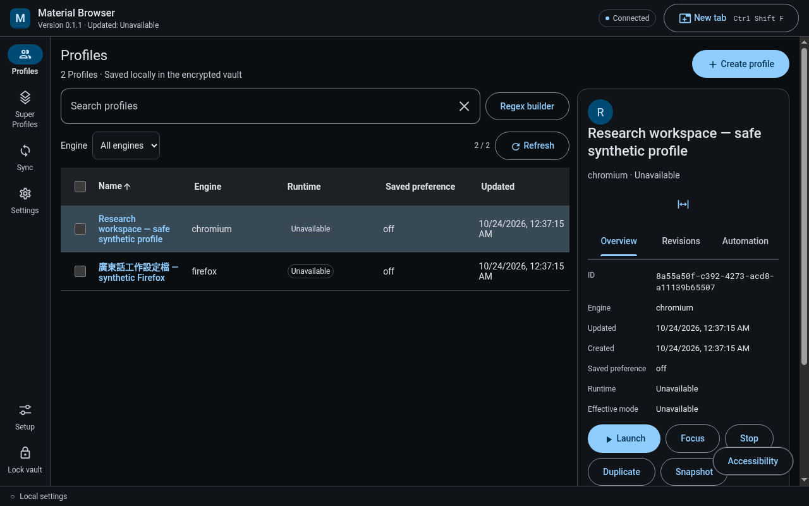
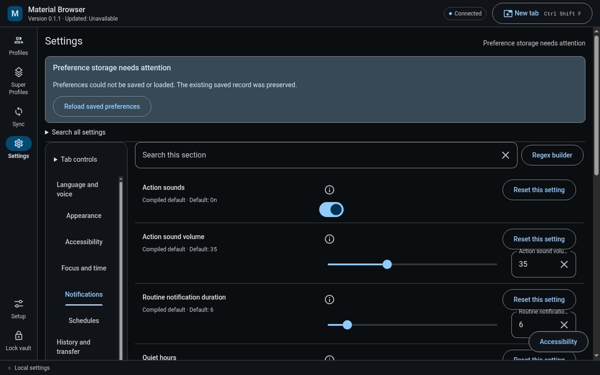

# Desktop evidence and current acceptance gap

The repository-owned design remake currently has no accepted runtime screenshots. Automatic approval review rejected its task-owned hidden-runtime service launch before execution. Actual rebuilt-application captures, inspection, layout parity and README delivery remain pending. The captures below are historical WorldLens evidence for their stated source.

The historical WorldLens desktop captures come from source `284fc88f94487a7716099469daadeec258d97b07`. See the [complete inspected set and verification limits](worldlens/README.md), [exact image inventory](worldlens/inventory.json) and [coverage record](worldlens/coverage.json).

These are genuine Linux Electron captures with a native Linux host and synthetic records. Startup theme and language variants do not prove Windows native preference saving. Windows packaging, physical input and audible output require separate evidence.

[Previous desktop evidence article](archive-baa9512.md) · [Earlier image archive](../archive.md)
