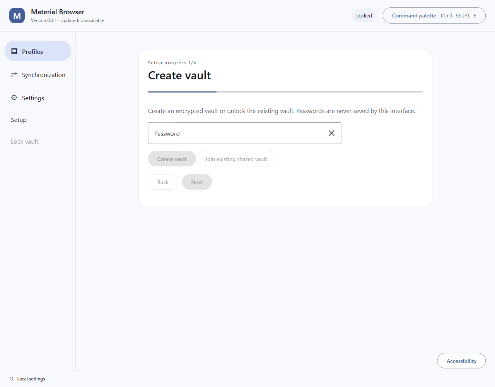
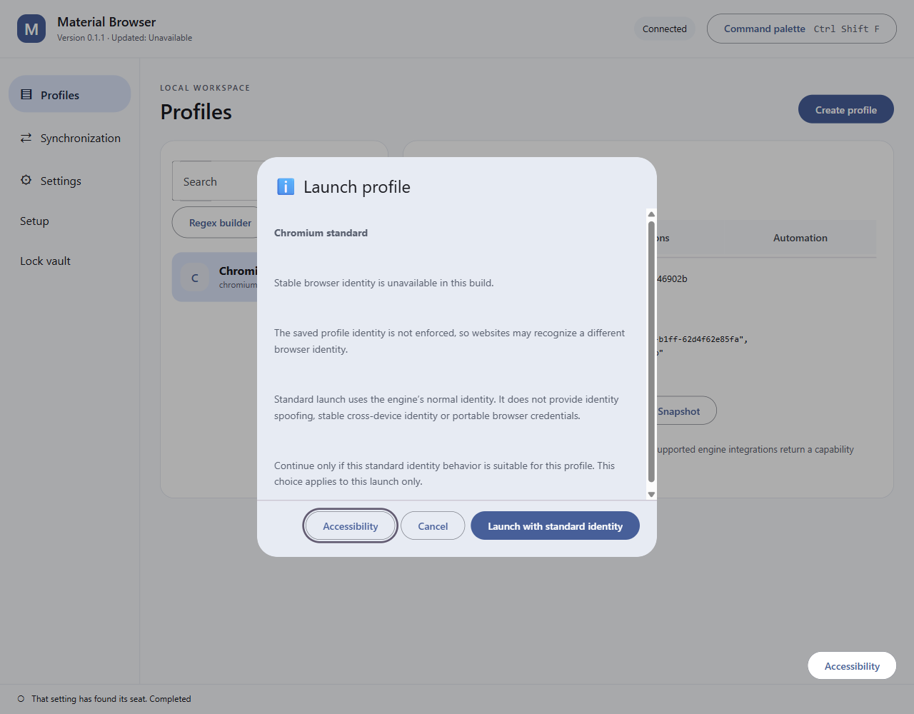
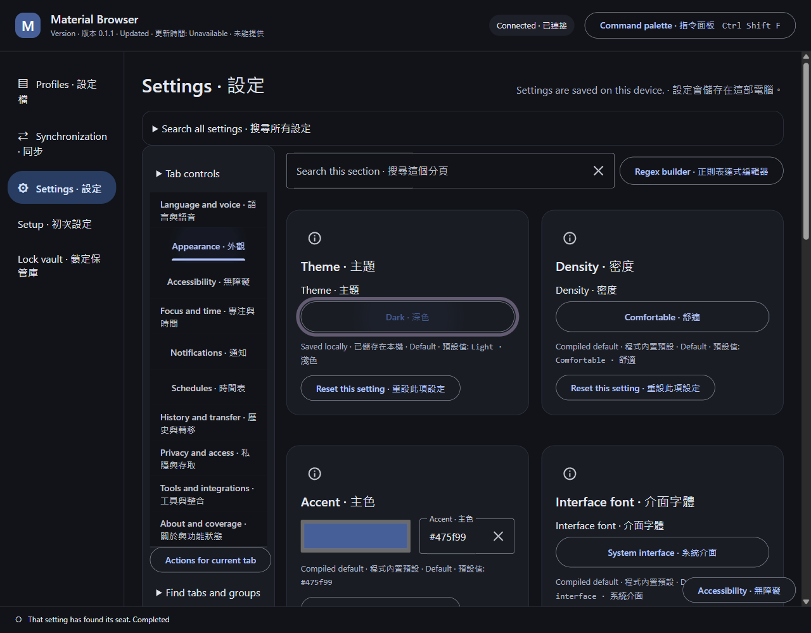

# Desktop evidence archive at source 5922074

The following is the unchanged previous current-evidence article. Its dates, images and source binding remain historical.

# Current desktop evidence

Source: `5922074548f3a79f56b69c25b67826c0be3e209e`. Local package version: 0.1.1. The exact root build-installer.bat -Component Desktop completed with exit 0. The native executable is byte-identical to the `9011b28` host that passed all six bundled engine/mode launch-stop cases.

The images use synthetic data on a named hidden desktop through the Lowlevel route and one exact debugging target. Original PNG bytes were inspected, staged without transformation, hashed and read back. All three prospective observation intervals completed with zero console errors, page errors and unhandled exceptions. The six recorded owned processes were proven absent and the exact desktop closed afterward.

The 1280 by 1000 viewport uses logical emulated scale 1. Capture dates and UTC timezone come from the producing observation receipts, not filenames or file timestamps. The build timestamp records observed package readiness before launch, with the separate installer completion receipt retained privately. No private vocabulary was imported and no real user data, credential or unrelated window is visible.

These images do not prove native installation/update, complete physical scale coverage, keyboard-only access, full localization, all feature contracts or current offline-handbook runtime acceptance. Minimum-viewport dialog observations are separate from full workspace layout acceptance.

[Inventory](inventory.json) · [Public receipt summary](receipts-0.1.1.json) · [Historical desktop article and original images](archive.md)
