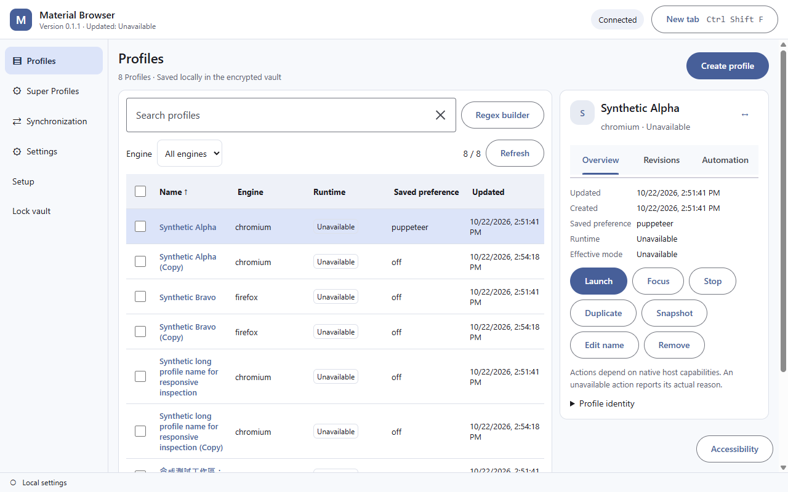
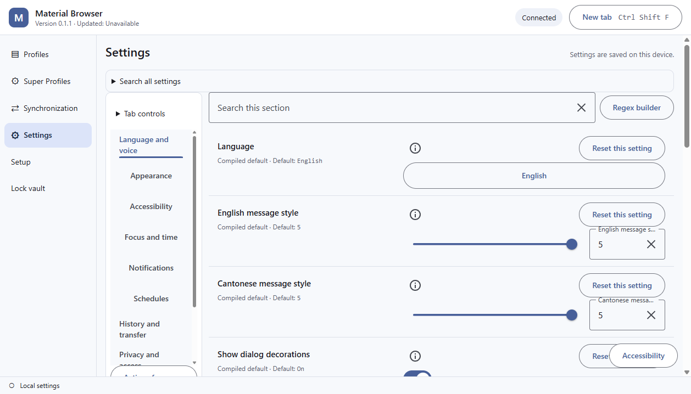
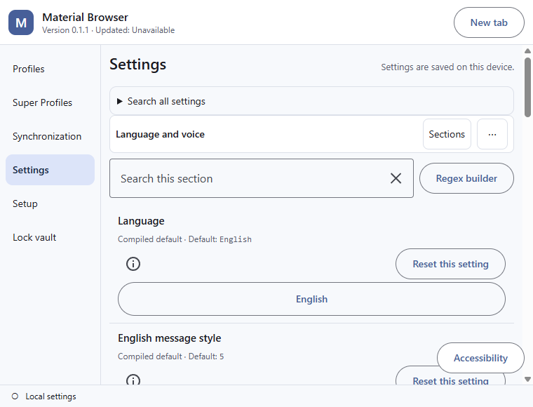
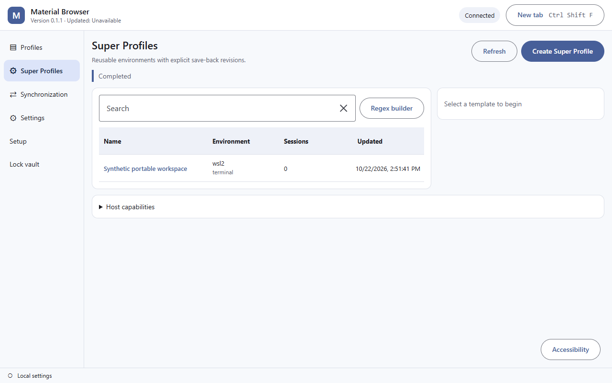
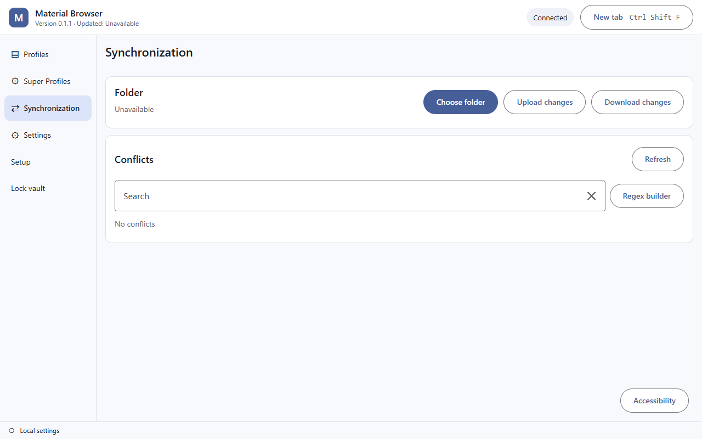
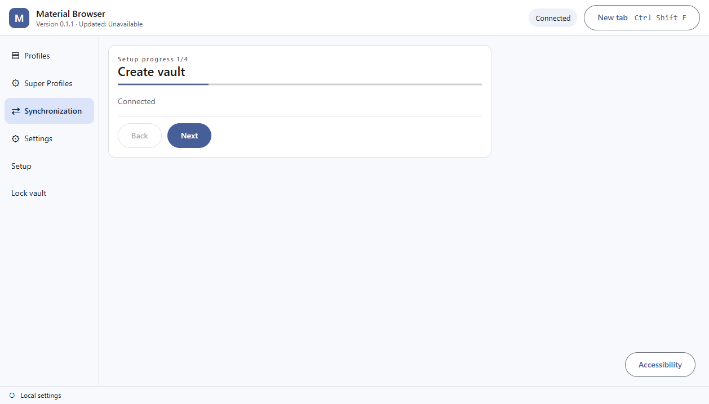
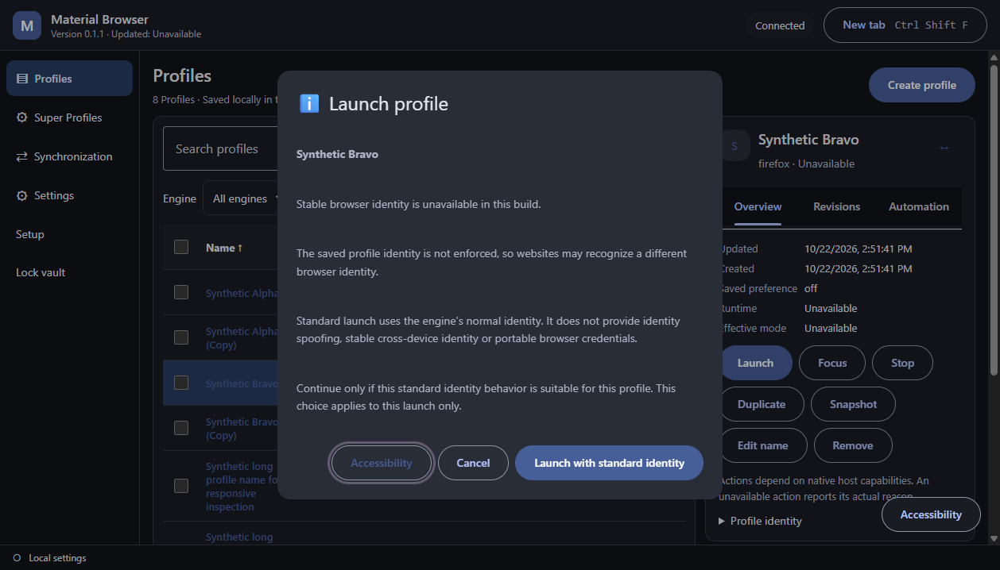
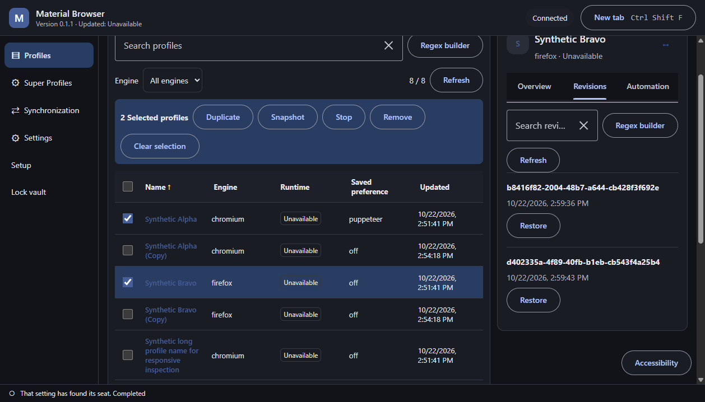

# Historical desktop evidence at source baa9512

The previous current-evidence article follows unchanged. Its source, images and original verification claims are historical after the WorldLens adaptation.

# Current desktop evidence

The current desktop rewrite images and receipts are in the [source-bound GUI inventory](gui-rewrite/README.md), at source `baa9512ecbc2727929547059f3b5d95f7cde989f`.

The GUI source and focused interactions are preserved; full product acceptance is incomplete. The representative matrix contains 138 completed cells, with the remainder and broader states explicitly listed in [coverage](gui-rewrite/coverage.json). Scale emulation, native input, guest lifecycle, conflict resolution, installation/update and deployed documentation have separate verdicts.

[Current inventory](gui-rewrite/inventory.json) · [Receipt summary](gui-rewrite/receipts.json) · [Earlier presentation archive](../archive.md)
