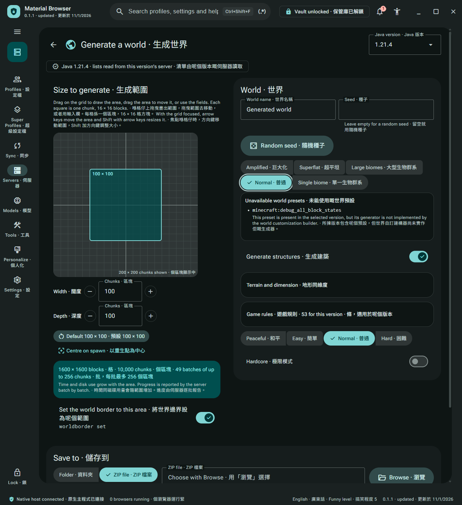
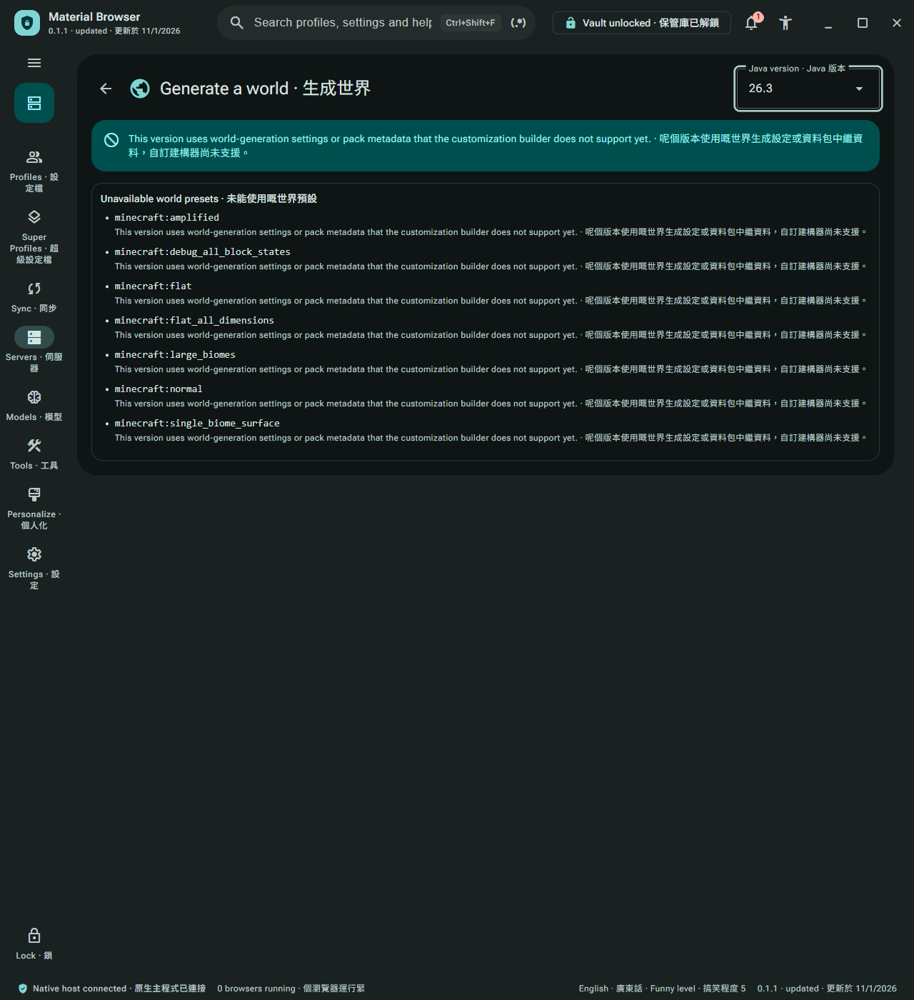
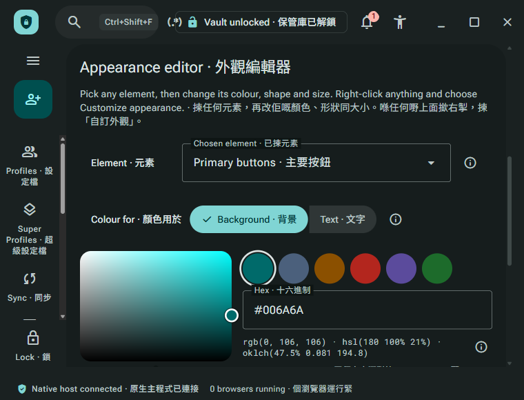

# Current desktop evidence, 1 November 2026

These three unedited screenshots come from source
`62563ae1626f966bd063ce0e38c53353de84ba22`, produced by the exact
`build.bat -Component Desktop` entrypoint. The renderer SHA-256 is
`e396adfbbc514edd48dc16a3c2dee8a83b7bf513bed991cf2eeec7ec23fbc820`.
The [inventory](inventory.json) records exact image hashes, UTC capture intervals,
screen states and measured viewports. Earlier README presentation is preserved in the
[source-bound image archive](readme-image-archive.md); its original images and metadata
have not been deleted, changed or relabelled.

All three supported promotion receipts passed before the evidence commit at the captured
source. The [validation summary](validation.json) records their exact results. Removing a
required inventory ID caused rejection; restoring the original bytes passed again. The
promoted PNGs were reopened for visual inspection after byte-identical staging.

## Supported preset inventory

Minecraft 1.21.4 exposes five selectable presets and retains the discovered debug preset
with an explicit unavailable reason. All twelve requested English, Cantonese and bilingual,
light/dark, normal/minimum viewport cases preserved that inventory. Scoped measurements
found no horizontal overflow across nested panes, preset groups, the reason, Random seed
or chips. Renderer ArrowRight input visited all five choices with matching focus and
selection. No EULA was accepted and no world generation was started.

## Explicit unsupported-version state

Minecraft 26.3 retains all seven discovered presets as noninteractive entries because its
customization schema is unsupported. Its readiness capability does not make generation
available. The older 1.19.3 readiness-unavailable case was also checked independently with
six retained presets. The verified archives and report caches were reused unchanged.

## Current minimum Personalize state

This representative bilingual dark view shows the upper Appearance controls after vertical
scrolling at 760 × 580. Lower controls remain below the fold. A real teal swatch was selected
in the isolated fixture; this image is not a new exhaustive Personalize matrix.

## Font delivery and observation scope

The built font checker passed with 267 declarations, 303 references, 188 unique assets and
all six required fonts matching their source bytes. The policy remains exactly
`font-src 'self'`. Cached initial/post-matrix diagnostics and renderer reloads observed from
before reload until document, language and fonts were ready reported zero font CSP blocks,
uncaught exceptions, console errors or resource failures. The English and bilingual reloads
observed respectively two and fourteen successful local font responses.

The route was a named off-screen desktop launched through the installed direct CLI, with
exact process/window ownership and single-target CDP checks. Images are page-only captures
at requested scale 1 and observed DPR `1.0000000298023224`: the two inventory images are
1280 × 1400, and Personalize is 760 × 580. This is page emulation and renderer input, not
physical display-scaling, physical keyboard, full native-process startup, screen-reader,
installer or release proof. Complete visual parity and world generation are not claimed.

All originals were decoded and visually inspected. No pixels were cropped, annotated,
resized or recompressed. Native identities, machine paths and full interaction receipts
remain outside tracked documentation. The owned application closed normally and its
recorded process tree and named desktop were verified absent.
