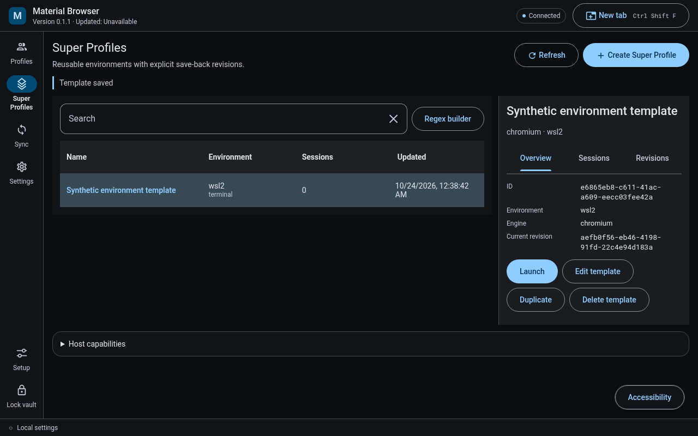
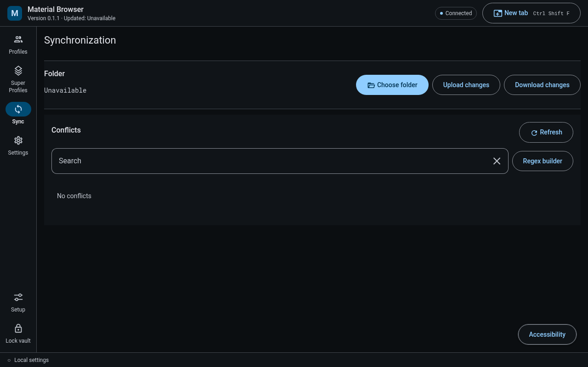
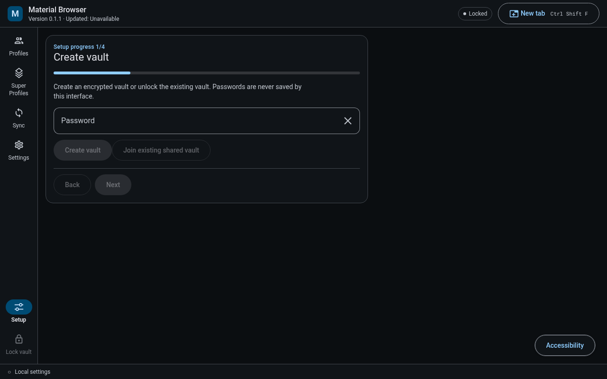
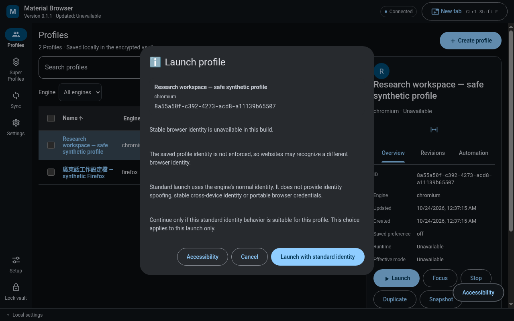
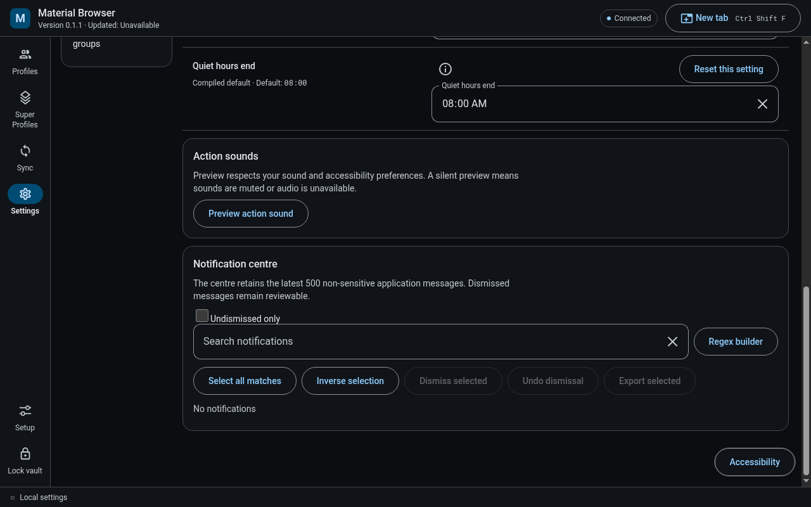
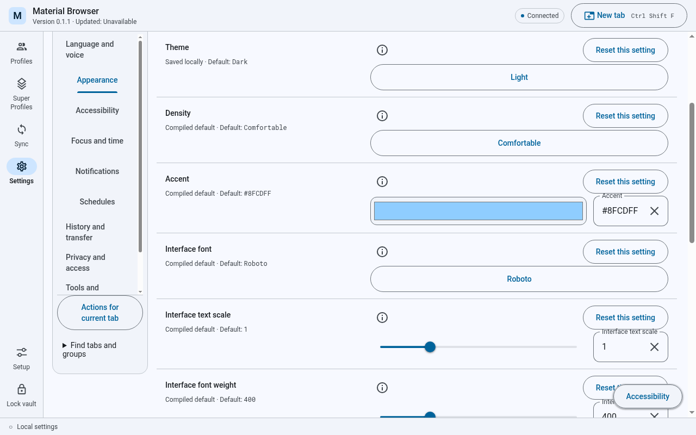
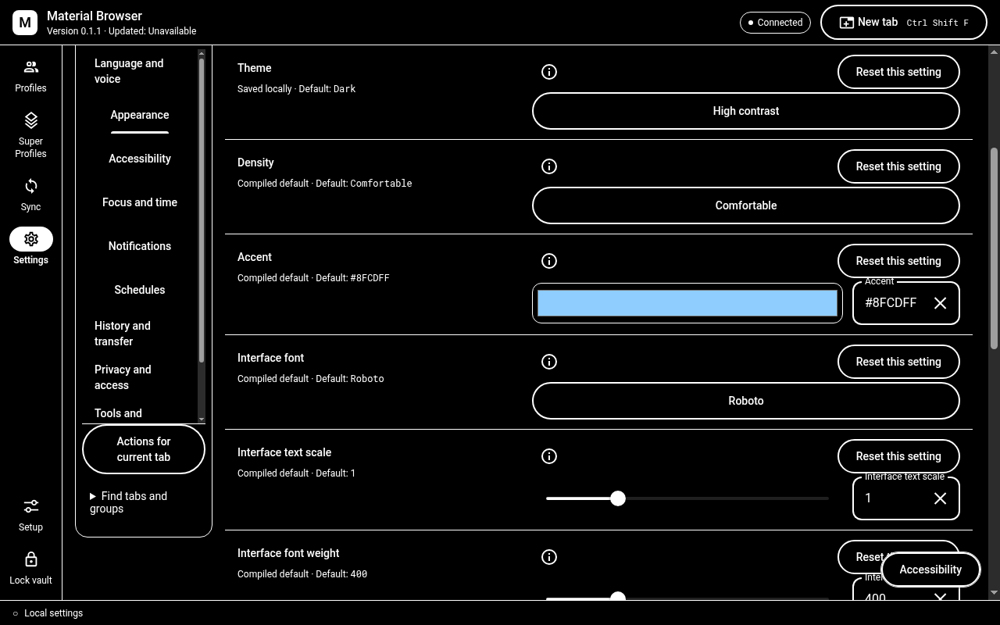
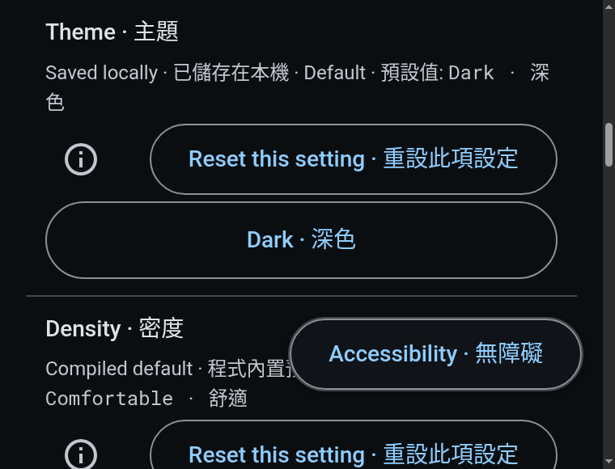

# WorldLens desktop evidence

These original PNGs show the production desktop renderer at source `284fc88f94487a7716099469daadeec258d97b07`, with the real Electron main/preload and locally built Linux Rust host. A task-owned Xvfb display and isolated synthetic vault kept the visible desktop and existing user data untouched. The images were decoded, visually inspected and copied without changing their bytes.

The [exact inventory](inventory.json) binds each image to its source, built artifact, raw receipt, dimensions, language, theme and actual Electron zoom factor. The [coverage record](coverage.json) lists measured states and the remaining gaps. Full raw receipts remain private because they contain local process and profile paths.

## Workspaces and review dialogs

The native host created the synthetic profiles and saved template metadata. The launch review was opened and cancelled. These observations do not establish browser launch, guest provisioning, synchronization transfer or destructive confirmation behavior.

## Sound and appearance

Language and theme variations use the application's legacy presentation reader with explicitly seeded startup preferences in the isolated profile. This is distinct from successful native saving. The existing Windows mutex implementation rejects native preference persistence on Linux, and the interface correctly shows its storage warning. No locking or persistence boundary was bypassed.

## Scope of verification

The final runs produced 143 captures: 137 main captures and six focused supplemental captures. All 72 representative Appearance tuples completed; 61 of 241 inventory states have observations, with 180 exact gaps retained in the coverage record. Ten publication candidates received independent visual and privacy review. [Runtime summary](runtime-summary.json).

The representative Appearance matrix uses 1280 × 800 and 760 × 580 windows, English, Cantonese and bilingual text, light, dark and high contrast, and actual Electron zoom factors of 100%, 125%, 150% and 200%. Normal captures also cover the shell, all ten Settings categories, profiles, Super Profiles, synchronization, setup and review dialogs. Captured states and inspected images are recorded separately; the matrix does not cover every state in the design inventory.

Local source checks passed 126 desktop tests, with one Windows mutex test skipped on Linux, plus TypeScript and the production renderer build. The renderer used the bundled Roboto assets; installed-font discovery remains a separate Windows capability.

The floating Accessibility entry can overlap content at some scroll positions; the affected Reset control was reached by scrolling and then clicked. This is a retained presentation limitation.

This evidence does not establish Windows installation or update, native preference restart persistence, physical display scaling, native Windows keyboard delivery, screen-reader speech, audible speaker output, or guest lifecycle acceptance. Windows build and release results are recorded separately. [Earlier images and original provenance](../../archive.md) remain historical.

## 廣東話

以上係實際編譯桌面介面嘅原始畫面，配合真正 Linux 原生主程式同隔離嘅測試資料，冇修改圖片。清單記錄來源、程式雜湊、語言、主題、視窗大小同實際介面縮放。

已檢查設定檔、Super Profile、同步、設定、初次設定同確認對話框嘅外觀。語言同主題測試用隔離啟動設定，唔代表原生設定已成功儲存。Linux 未能使用現有 Windows 鎖定機制，所以畫面保留正確嘅儲存提示；Windows 安裝、儲存後重新啟動、實體聲音同客體生命週期仍需獨立驗證。
