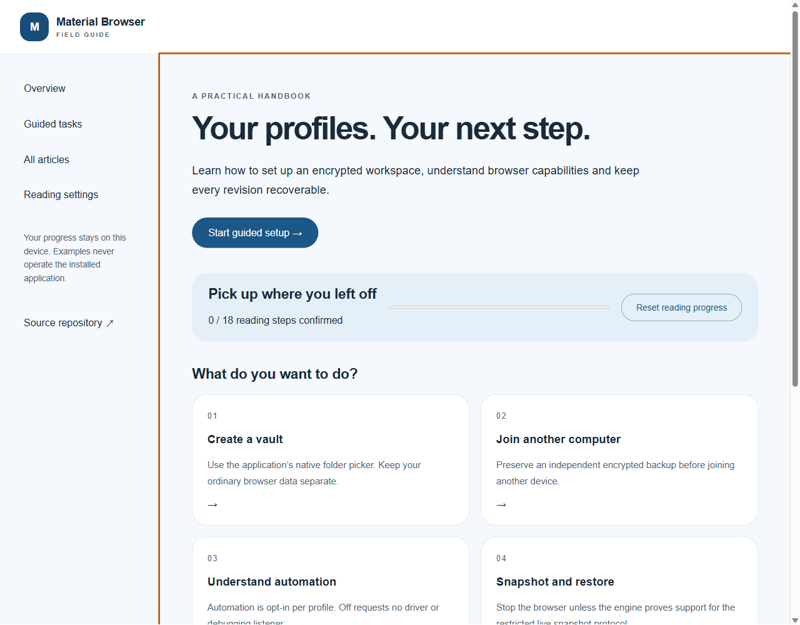
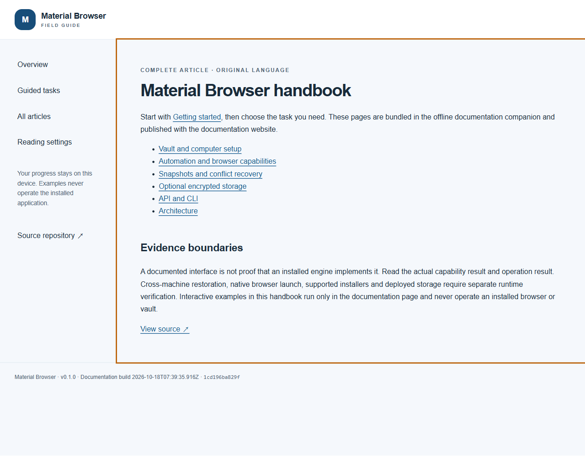
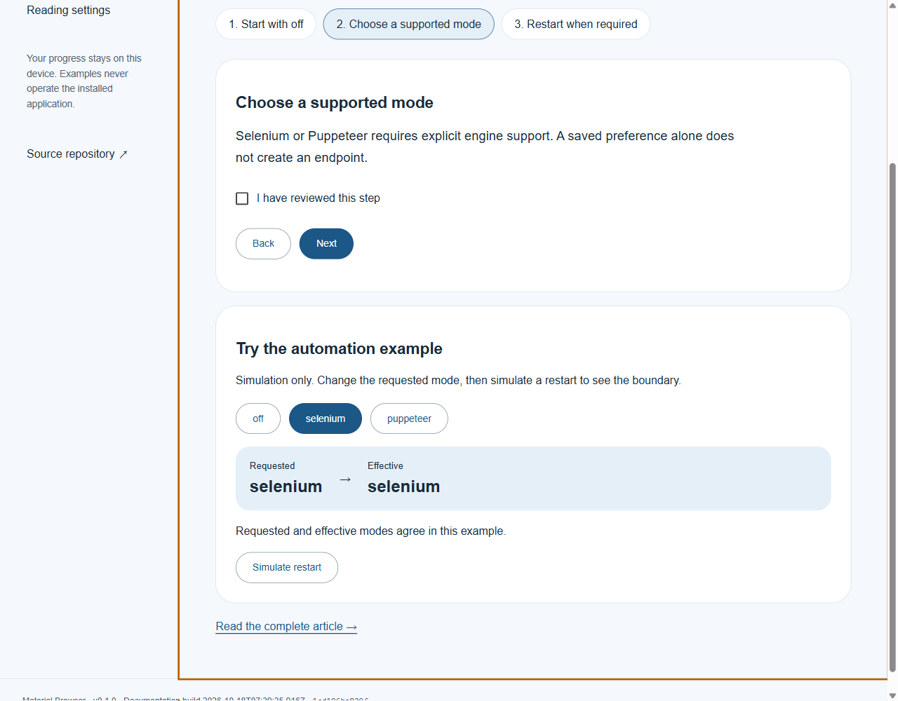
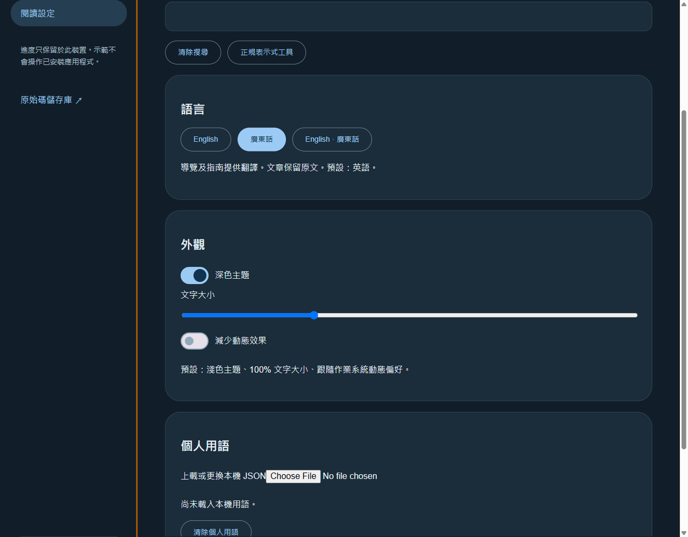

# Portable handbook capture evidence

## Exact candidate

These four images were captured from the real portable documentation companion at source
`1cd196ba829f65d17c5a95bdf2ea5f6078f0009e`. The exact production command was
`build-installer.bat -Component DocsCompanion`, which completed with exit code 0 from
`2026-10-18T07:39:22.0224037Z` to `2026-10-18T07:41:44.9510726Z`.

The unsigned `Material-Browser-Handbook-0.1.0-x64.exe` is 100494041 bytes, SHA-256
`dcdd08b18afb848cb6d6f8020abf43a86ea8d50026f00ee51b891243295e2f49`.
It was launched from a directory containing only that executable, with a new isolated reading
profile on a named off-screen desktop. The portable launcher extracted its bundled runtime
temporarily and removed that extraction after normal shutdown. No adjacent runtime folder was
used to supply the launch.

The capture viewport was explicitly emulated at **1280 by 1000, scale 1**. This is page-only
rendering evidence, not proof of physical display-scale coverage. The original PNG bytes were
inspected, staged without transformation and read back against their original SHA-256 values.
The later commit that records these images does not change their producing source identity.

## Reading overview and complete wiki

The overview provides guided reading tasks and visitor-owned progress. It does not perform
vault, browser, storage or other native product operations.

All 21 bundled article routes rendered, including every wiki article and the native automation
verification article. All eight embedded content files matched their bundle manifest, and all
three approved desktop images decoded. A separate real link activation opened the Getting
started article from the wiki home.

## Guided reading and local preferences

The guide retained its confirmed first reading step and resumed at the second step after reload.
The explanatory automation example changed its requested mode, then applied that mode only
after the simulated restart. These are documentation interactions, not native browser automation.

Language and theme were changed through the rendered controls and survived reload. A separate
full-process restart confirmed that Cantonese, dark theme, reading progress, guide position,
the simulation state and regex-search preferences remained in the isolated reading profile.
The restart image is deliberately excluded from this four-image inventory because that run did
not enable its console/page-log observation interval. No missing diagnostic counts were inferred.

## Security observations and limits

During the initial capture interval there were zero observed unhandled exceptions, console
errors and error-level page logs. The renderer exposed no Node globals or preload bridge.
An intentional external-link navigation was canceled, without an unexpected network request.
Separate runtime probes confirmed that a new window was denied and notification permission
returned denied. Both owned runtime launches closed normally, their debugging listener was
absent afterward, and their off-screen desktops closed. The isolated reading profile was retained.

This evidence does **not** establish updater behavior, native installation, native browser
capabilities, complete Settings functionality, a complete language/accessibility/display-scale
matrix, release publication or full product acceptance. The handbook retains the documented
required-feature gaps. The hosted documentation has separate source and deployment evidence;
these portable captures do not stand in for that verification.

See the [exact image inventory](inventory.json), [public build and capture summary](receipts.json),
and [documentation delivery description](../../features/documentation/README.md).
Full operational receipts remain private; public records omit local paths, window handles and
session identities.
